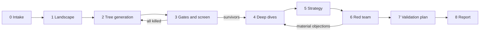

<!-- GENERATED by tools/build_spec.py from skills/marketplace-opportunity/. Do not edit by hand. -->

# Marketplace opportunity framework: full specification

Single-file view for human readers. Agents should load the modular files via `skills/marketplace-opportunity/SKILL.md` instead.

## Principles

### What this framework does

It takes a venture idea and produces, with evidence:
- a **market tree** from sector (L0) to micro-niche (L4);
- the candidates killed and why;
- a shortlist of **paths** (entry wedge → expansion sequence) scored with ranges;
- a strategy per path;
- an independent **red team**;
- a **validation plan** of cheap experiments aimed at the riskiest assumptions.

### Its limit, which must be stated in every output

Desk research can screen out bad ideas and generate well-formed hypotheses. It cannot establish demand, supply willingness or liquidity. Judge the output on how well it kills bad ideas cheaply and points to the right experiments, not on how confidently it picks winners.

### Principles

1. **Transaction first.** Every node reduces to at least one transaction card (`02-transaction-card.md`). If it cannot, it is a theme, not a market.
2. **Paths, not points.** Recommend an entry niche plus an expansion sequence plus a monetisation stack. A great niche that leads nowhere, and a large market with no viable wedge, are both poor recommendations.
3. **Gates before scores.** Kill criteria (`config/gates.yaml`) run before scoring. *Unknown* is never a pass; it becomes a priority assumption.
4. **Evidence or assumption.** An unsourced claim is an assumption, logged with a widened range and lower confidence.
5. **Disconfirm before confirm.** Search for reasons each candidate fails. Base rates are grim (`knowledge/historical-patterns.md`, `knowledge/failure-library.md`).
6. **A marketplace is one option, not the goal.** Test against SaaS, first-party retail, lead generation, a managed service, a community, or a tool that later grows a network. "Do not build a marketplace" is a valid conclusion.
7. **2026-aware.** Profit sits above the commission line. AI substitution and agent bypass are first-class risks. Regulators deputise platforms (`knowledge/context-2026.md`).
8. **Calibrated, not precise.** Ranges, confidence levels and sensitivity to weightings. No single scores to one decimal place.
9. **The user's idea gets no special treatment.** Assess it as if a stranger had submitted it. Optimism is the most common failure mode of agents on this task.

### How much to trust each part

| Part | Status |
|---|---|
| Theory core (`knowledge/theory.md`) | High confidence: established literature |
| Practitioner heuristics (`knowledge/heuristics.md`) | Moderate: survivor-derived |
| 2026 context (`knowledge/context-2026.md`) | Moderate and perishable; check `valid_until` |
| Gates, rubric anchors, weights, operators, pipeline | Design judgement. A starting configuration to tune with `docs/testing-the-framework.md` |

## Pipeline

### Stages



| Stage | Purpose | Load | Write | Checkpoint |
|---|---|---|---|---|
| 0 Intake | Turn the idea into a structured brief: hypothesis, entry point, geography, founder assets, capital, horizon, risk appetite, exclusions, weight profile | `templates/brief.yaml`, `knowledge/*` | `brief.yaml` | **Human confirms the brief** |
| 1 Landscape | Map the sector's value chain, current intermediaries and their take, and the main regulation | `02-transaction-card.md`, `11-evidence.md`, `13-data-sources.md` | First transaction cards; evidence | none |
| 2 Tree | Generate L0–L4 nodes under at least three lenses; deduplicate; cap at 30–60 L3/L4 | `03-market-tree.md`, `config/operators.yaml`, `knowledge/historical-patterns.md` | Nodes in `ledger.yaml` | none |
| 3 Screen | Run the gates, then a quick score on cheap evidence; select 5–8 paths | `04-gates.md`, `config/gates.yaml`, `05-scoring.md`, `config/rubric.yaml`, `knowledge/failure-library.md` | Gate results; kill log; shortlist; `scripts/score.py` output | **Human confirms the shortlist** |
| 4 Deep dive | Full template per path; parallel research; models in code | `07-deep-dive.md`, `06-sizing.md`, `templates/sizing_model.py` | `deep-dives/<path>.md`; `models/`; scores | none |
| 5 Strategy | Wedge, cold start, monetisation, trust, regulation, agents, expansion, exit | `08-strategy.md`, `knowledge/heuristics.md` | Strategy section per path | none |
| 6 Red team | Independent critic attacks each path | `09-red-team.md`, `prompts/critic.md` | `red-team.md`; revised scores | none |
| 7 Validation | Rank assumptions by impact × uncertainty; design cheapest tests | `10-validation.md` | `assumptions` in the ledger | **Human confirms before any spend** |
| 8 Report | Synthesise | `templates/memo.md`, `prompts/synthesiser.md` | `memo.md` | none |

### Roles

| Role | Model guidance | Input | Output |
|---|---|---|---|
| Orchestrator | Thinking model | Brief, ledger, knowledge pack | Tree, gate and score adjudication, strategy |
| Researcher (parallel) | A faster model is fine | One node or question, narrow brief | Evidence entries only (`schemas/evidence.schema.json`), no conclusions |
| Modeller | Any model with a code sandbox | Parameters with evidence ids | Model file, P10/P50/P90 ranges, sensitivity |
| Critic | Separate context; ideally a different model | Memo draft, ledger, evidence. **Not** the orchestrator's reasoning | Ranked objections and required changes |
| Synthesiser | Thinking model, fresh pass | Ledger, deep dives, red team | `memo.md` |

If the runtime cannot spawn sub-agents, run the roles sequentially. Keep the critic in a fresh context, or at minimum have it read only the files listed above.

### Run folder

Create `runs/<run-id>/` (git-ignored by default, because analyses are usually private):

```
runs/<run-id>/
  brief.yaml
  ledger.yaml        # schemas/ledger.schema.json
  evidence.yaml      # schemas/evidence.schema.json
  models/            # sizing and unit-economics code and outputs
  deep-dives/        # one file per shortlisted path
  red-team.md
  memo.md
```

Validate after every stage: `python scripts/validate_ledger.py runs/<run-id>/ledger.yaml`.
Score whenever scores change: `python scripts/score.py runs/<run-id>/ledger.yaml`.

### Budget (starting point)

About 20% on landscape and tree, 15% screen, 40% deep dives, 15% red team and 10% validation and report. The commonest failure is spending the budget on breadth and producing 50 shallow ideas. Respect the caps in `config/operators.yaml`.

## The transaction card

Every node in the tree carries at least one card. A node is ready to score only when its card is filled from evidence, not imagination. Schema: `transaction_card` in `schemas/ledger.schema.json`.

| Field | Question |
|---|---|
| buyer | Who pays? Segment, count, and whether they are the decision-maker |
| seller | Who supplies? Segment, count, fragmentation |
| object | What changes hands: goods, a service, access, capacity, time, data, risk transfer or an outcome guarantee? |
| job | Why the buyer transacts |
| trigger | What forces the purchase: urgency, a mandate, a life event or a schedule |
| frequency | How often a buyer transacts, and with how many different suppliers |
| aov | Typical order value and the range |
| current_channels | How it happens today, including informal channels (WhatsApp or Facebook groups, forums, spreadsheets, word of mouth) |
| current_intermediary | Who sits in the middle today and what they take |
| frictions | Search cost, trust gap, price opacity, payment risk, logistics, compliance, scheduling |
| information_asymmetry | Who knows quality, and can it be verified before purchase? |
| persistence | After the first match, do the same parties keep transacting? This drives leakage (gate G2) |
| liability | Who bears risk if it goes wrong, and could the platform credibly take some of it? |
| regulation | Licences, safety rules, worker status, tax reporting, consumer law |
| ai_exposure | Could AI do the service itself (substitution)? Could a buyer's agent do the matching (bypass)? |
| evidence | Evidence ids supporting the card |

### Quality bar

- **Name the trigger.** "Small businesses need help" is not a trigger. "Landlords must renew a certificate every 12 months" is.
- **Count both sides.** If the agent cannot estimate even an order of magnitude for supply and demand in the entry niche, the card is incomplete.
- **Show the transaction happens today.** At least one evidence item must show it happening now, informally counts. If nobody transacts today, the idea is creating a market, not a marketplace: higher risk, flag it.

## Market tree generation

### Levels

L0 sector → L1 market → L2 segment → L3 niche → L4 micro-niche. Evaluation emphasis shifts down the tree:
- At L1–L2 the questions are about terminal value and structure.
- At L3–L4 the questions are about wedge quality, time to liquidity and hard-side access.

An **L4 micro-niche** is small enough that a small team can reach liquidity within months, and has a distinct vocabulary and buying criteria.

**Illustrative path** (shows mechanics only; not an assessment):
- L0 property services
- L1 landlord compliance services
- L2 safety certification for private rentals
- L3 certification for HMO landlords in London
- L4 bundled annual certification booking for HMO landlords in one borough

This is a regulation-first entry: a recurring mandate supplies frequency and urgency.

### Procedure

1. **Classify the entry point** of the user's idea (`config/operators.yaml → entry_points`). Each entry point favours certain operators.
2. **Pick at least three lenses** (`lenses`) that differ meaningfully. Generate candidates under each lens separately. One-pass generation collapses into the same few obvious ideas.
3. **Apply operators:**
   - `descend` operators to move down the tree;
   - `transform` operators to change the shape (flip sides, change the object, change matching mode, unbundle a horizontal, tool-to-network, compliance-led, agent-side, AI-revived graveyard);
   - `ascend` operators to sketch the expansion ladder for each promising L3/L4 node.
4. **Ground every node.** It needs a transaction card and at least one evidence item showing the transaction happens today. Use `micro_niche_signals` to find them.
5. **Cluster and deduplicate** across lenses. Merge near-duplicates and keep the best-evidenced version.
6. **Respect the caps:** 30–60 L3/L4 candidates. More dilutes depth.
7. **Reject templated suggestions.** "Uber for X" must be rewritten with named buyers, suppliers and trigger, or discarded.
8. **Record provenance.** For each node, record the lens and operator in the ledger, so ablation tests can tell which lenses produce survivors.

### Paths

A path is an ordered list of node ids: the entry wedge first, then expansion steps upwards or sideways. Create paths for nodes that survive the screen. Every path needs an `expansion_plausibility` score: how likely the wedge's network, brand and data are to carry over to the next step. `scripts/score.py` caps a path at its weakest component plus a margin (`config/weights.yaml → path`).

## Gates

Gates run **before** scoring, so effort goes into candidates that can survive.

### Rules

- Each gate returns `pass`, `fail` or `unknown`, with a one-line rationale and evidence ids.
- **fail:** set `status: killed` and write `kill_reason`, or redesign. A redesign is a new node (a narrower niche, a managed model, a different object) and its parent stays killed.
- **unknown:** never a pass. Add an assumption to the register with impact 4–5, and gather evidence before shortlisting.
- **G1 can conclude that the right answer is not a marketplace.** Record it in `alternative_model` (saas, first_party_retail, lead_generation, managed_service, community). That is a useful output, not a failure of the run.
- **G2 (leakage) and G7 (AI substitution)** are where 2026 differs most from the 2015 playbook. Give them the most evidence.
- **Re-run gates** when a deep dive or the red team changes the evidence.

### Gate order (cheapest evidence first)

G1 fit → G4 regulation → G5 incumbent → G7 AI substitution → G2 leakage → G3 atomic network → G6 economics. G6 usually needs the Stage 4 model, so at Stage 3 it can stay `unknown` unless the case is obvious.

### Kill log

Killed nodes stay in the ledger. The kill log is a valuable output: it shows the founder which directions were tested and why they fail, and it lets the red team check for over-zealous kills.

### Gate definitions (from config/gates.yaml)

| Gate | Name | Fails when | Typical redesign |
|---|---|---|---|
| G1 | Marketplace fit | No independent second side, or the platform adds little to matching. | saas, first_party_retail, lead_generation, managed_service, community |
| G2 | Leakage | High repeat with the same counterparty AND the platform cannot own payment, the work, a guarantee or ongoing tooling. | managed_model, embedded_workflow_tools, saas_not_marketplace |
| G3 | Atomic network feasibility | The smallest useful network needs more participants, money or time than the brief allows. | narrow_niche, concentrate_in_time_and_space |
| G4 | Regulation and liability | Activity prohibited; licence unobtainable; liability uninsurable or out of proportion to the take. | change_object, change_role_to_referral |
| G5 | Entrenched incumbent | A dominant platform holds the niche and the candidate has no differentiating wedge. Example - Vinted at 50-60% of UK consumer-to-consumer fashion GMV in 2025 (CMA, as relayed). | sub_niche_incumbent_serves_badly, abandon |
| G6 | Economics | No take rate covers payments, support, trust and safety, and compliance at target scale while staying acceptable to both sides. | change_monetisation_stack, abandon |
| G7 | AI substitution | The traded service is likely to be automated end-to-end within the horizon (commoditised writing, translation, simple design or code). | sell_outcome_or_liability, abandon |

## Scoring

### Rules

1. **Score against the anchors** in `config/rubric.yaml`. Every criterion runs 1–5 and **5 is always favourable**: inverse risks such as leakage, multi-homing and AI substitution are phrased so that 5 means low risk. Interpolate 2 and 4.
2. **Every score has** `central`, `low`, `high`, `basis` and `evidence`.
   - `basis: evidence` requires at least one evidence id of moderate or high confidence.
   - Otherwise use `basis: assumed` and widen the range (typically ±1.5 or more).
3. **Missing criteria** are treated by the script as maximally uncertain (central 3, range 1–5). Coverage will show it.
4. **Never do weighted arithmetic in prose.** Run `scripts/score.py`.

### Profiles

Run every shortlist under at least three profiles (`config/weights.yaml`): **balanced**, **venture**, **bootstrapped**, plus **strategic** for corporate builders. `score.py` flags rank flips. If the ranking flips, the choice depends on the founder's values (ambition, capital, time), not on analysis. Say so.

### Reading the results

- **Attractiveness × confidence.** High score with low coverage means "research next", not "build". Low score with high coverage means "kill with confidence".
- **Ranges overlap.** If two paths' ranges overlap substantially, do not rank them strictly. Report them as tied, and say what evidence would separate them.
- **Path score.** It combines wedge quality (the first node), terminal value (the highest-level node in the sequence) and expansion plausibility, capped at the weakest component plus a margin. A brilliant wedge with no route upwards, or a large market with no viable wedge, cannot score highly.
- **Coverage.** The share of weighted criteria backed by evidence. Below about 50% at Stage 4, the deep dive is not finished.

### Quick scoring at Stage 3

Score only the criteria that cheap evidence can support (structure, regulation, AI substitution, incumbent proximity). Leave the rest missing and let the script widen the ranges. Shortlist on gates plus the top ranges, keeping at least one contrarian candidate whose upside range is high.

### Rubric anchors (from config/rubric.yaml)

#### Market structure (default weight 25%)

*Is there a fragmented, frequent, high-friction transaction a platform can improve?*

| Criterion | 1 | 3 | 5 |
|---|---|---|---|
| Supply fragmentation | A handful of suppliers control most supply | Mid-sized operators plus a long tail | Thousands of small independent suppliers with no effective aggregator |
| Demand fragmentation | A few large buyers who procure directly | Many buyers, but purchasing concentrated through gatekeepers or procurement | Many independent buyers each making their own purchase decisions |
| Frequency x value | Rare and low value | Either frequent or high value, not both | Frequent and meaningful value, or rare but very high value with a large trust gap |
| Matching friction today | Buyers find suitable suppliers easily; prices are transparent | Search takes effort; some price opacity | Heterogeneous supply, scarce information, long lead times or wide price dispersion |
| Trust gap the platform can close | Quality is obvious before purchase | Some risk, managed informally (referrals, word of mouth) | Quality unverifiable before purchase and costly to get wrong; verification or guarantees would change behaviour |

#### Economics (default weight 20%)

*Can the platform capture enough value per transaction to be a business?*

| Criterion | 1 | 3 | 5 |
|---|---|---|---|
| Headroom against the incumbent intermediary | Incumbent intermediaries take little and serve well | Moderate take, some friction | Large fees for poor service, or opaque pricing the platform can undercut |
| Payment-flow control | Payment happens off-platform by custom (cash, invoice on completion) | Can be brought on-platform with incentives | Naturally on-platform (escrow, deposits, instalments, insurance, subscriptions) |
| Ancillary monetisation potential | No credible revenue beyond the take rate | Some ancillary lines (software, payments) once established | Strong ancillary lines reachable at modest scale (fulfilment, financing, insurance, compliance tooling). Ads count only if scale is plausible. |
| Unit economics plausibility | Contribution negative at any plausible take rate | Positive contribution only at optimistic take rate or repeat rate | Positive contribution at a conservative take rate with plausible acquisition costs |

#### Liquidity and defensibility (default weight 20%)

*Can liquidity be reached cheaply, and will it hold?*

| Criterion | 1 | 3 | 5 |
|---|---|---|---|
| Atomic network size and time to liquidity | Needs national or global scale before it is useful | City-level, thousands of participants | Useful with tens to low hundreds of participants in one community or area |
| Hard-side acquisition | Hard side is unreachable, uninterested or very expensive to recruit | Reachable with paid acquisition or significant sales effort | Reachable cheaply through a concentrated channel (association, register, community) with a clear reason to join |
| Network effects | None beyond the transaction itself | Local cross-side effects | Strong cross-side effects plus data or reputation effects that compound |
| Multi-homing (5 = low) | Both sides use several platforms at once at no cost | One side multi-homes | Switching or multi-homing is costly for both sides (workflow, reputation, inventory lock-in) |
| Leakage (5 = low) | Repeat bilateral relationship; platform adds nothing after the introduction | Some repeat, but the platform retains value (payments, scheduling, records) | Each transaction is with a new counterparty, or the platform owns fulfilment or the guarantee |

#### 2026 exposure (default weight 15%)

*How exposed is the opportunity to AI substitution, agent bypass, regulation and platform dependency?*

| Criterion | 1 | 3 | 5 |
|---|---|---|---|
| AI substitution (5 = low) | The core service is already largely automatable | Partly automatable; humans remain in the loop | Physical, licensed or liability-bearing work that AI augments rather than replaces |
| Agent-bypass exposure (5 = low) | Pure listing and search on commodity goods | Mixed | The platform owns fulfilment, payment or guarantees an agent must route through |
| Regulatory load and direction | Tightening against the model, or compliance cost disproportionate to take | Neutral or manageable | New duties create demand for the platform, or raise barriers the venture can meet |
| Discovery dependency (5 = low) | Depends on one gatekeeper (Google search, an app store, an AI assistant) for most demand | Mixed channels | Owned or community channels; repeat demand without paid discovery |
| Big-incumbent proximity (5 = far) | A dominant platform already serves the exact niche or can trivially add it | Adjacent incumbents could enter with effort | No large platform has the supply, workflow or licence to compete |

#### Timing and right to win (default weight 10%)

*Why now, and why this founder?*

| Criterion | 1 | 3 | 5 |
|---|---|---|---|
| Why now | Nothing has changed; earlier attempts failed for reasons that still hold | A plausible enabling change, weakly evidenced | A clear, evidenced change in technology, regulation, behaviour or cost that earlier attempts lacked |
| Founder access and insight | No access to either side and no domain insight | Indirect access (network, advisers) | Direct relationships with the hard side or a privileged distribution channel |

#### Strategic value (default weight 10%)

*Where does this lead, and who would buy it?*

| Criterion | 1 | 3 | 5 |
|---|---|---|---|
| Expansion options from this node | Dead end; no adjacent niches or stack extensions | Some adjacent niches or geographies | Clear ladder to larger markets and up the stack (payments, fulfilment, financing) |
| Exit routes | No plausible acquirers; IPO-only story | A few possible acquirers | Several active strategic acquirers in the category (recent comparable deals) |

### Weight profiles (from config/weights.yaml)

| Profile | structure | economics | liquidity | exposure | timing | strategic | Multipliers |
|---|---|---|---|---|---|---|---|
| balanced | 0.25 | 0.20 | 0.20 | 0.15 | 0.10 | 0.10 | - |
| venture | 0.20 | 0.15 | 0.25 | 0.15 | 0.10 | 0.15 | network_effects ×1.5, expansion_options ×1.5 |
| bootstrapped | 0.20 | 0.25 | 0.20 | 0.15 | 0.15 | 0.05 | atomic_network ×1.5, hard_side_acquisition ×1.5, unit_economics ×1.5, founder_access ×1.5 |
| strategic | 0.20 | 0.20 | 0.15 | 0.15 | 0.15 | 0.15 | founder_access ×1.5, incumbent_proximity ×1.25 |

## Sizing and unit economics

LLM agents are at their worst on market sizing. These rules exist to stop plausible fiction.

### Rules

1. **Bottom-up only.** Top-down and vendor figures are sanity checks at most, flagged low confidence. Resale and "industry" reports sponsored by operators are often survey-based and internally inconsistent.
2. **Count real populations,** from registries where possible. UK sources:
   - Companies House SIC codes and filed accounts;
   - ONS and Nomis business counts;
   - licensing and professional registers;
   - trade-association membership;
   - community and event sizes.

   Each input carries an evidence id.
3. **Triangulate with at least two methods.** For example, population × observed frequency × order value, set against incumbent revenue ÷ incumbent take rate. Report a range and a confidence level.
4. **Model in code** (`templates/sizing_model.py`). Use triangular (low, mode, high) inputs and report P10/P50/P90. Do no arithmetic in prose.
5. **Size the atomic network separately from the total market.** The size of the first network is often more decision-relevant than the size of the total market.
6. **Flag geography mismatches.** US benchmarks applied to a UK niche get a confidence penalty unless justified.

### Core identities

```
GMV            = transacting buyers × transactions per buyer per year × order value
Net revenue    = GMV × take rate + ancillary revenue
Contribution   = net revenue − payment costs − support and trust-and-safety − compliance − subsidies
Payback        = acquisition cost per buyer ÷ annual contribution per buyer
```

Leakage reduces on-platform repeat transactions. Model it explicitly, because it usually decides viability along with take rate and repeat rate.

### Outputs

- A model file in `models/`.
- A `sizing` block on the node: `gmv_low`, `gmv_high`, `currency`, `atomic_network`, `model_ref`, `confidence`.
- A sensitivity (tornado) table showing which inputs move contribution most. Those inputs become assumptions for Stage 7.

## Deep dive

One file per shortlisted path in `deep-dives/`, using `templates/deep-dive.md`. Run research in parallel where possible: one researcher per question, returning evidence entries only.

### Required content

1. **Transaction cards:** the primary card and any secondary cards.
2. **How it is done today:** formal intermediaries, horizontals, verticals, in-house solutions and informal channels.
3. **Competitive map:**
   - direct competitors;
   - horizontals serving the niche badly;
   - offline intermediaries;
   - likely entrants, including big platforms and AI assistants.
4. **Gate results,** re-checked with deeper evidence.
5. **Full scores** with evidence ids and ranges. Target coverage of at least 50%.
6. **Sizing and unit economics** (`06-sizing.md`).
7. **Liquidity plan:**
   - the atomic network definition;
   - which side is hard and how to seed it;
   - concentration in time and space;
   - the liquidity metric and its target, for example the share of requests matched within a set time.
8. **Trust design:** verification, escrow, guarantees, insurance, disputes and ratings, designed against rating inflation.
9. **Monetisation stack:** who pays, the take rate, and when ancillary lines become viable. Ads only if scale is plausible.
10. **Defensibility:** network-effect scope, switching costs, data, proprietary supply.
11. **AI and agent exposure:** a substitution scenario, a bypass scenario, and positioning (`08-strategy.md`).
12. **Regulatory map:** UK first, plus the EU and US if in scope. Cover product safety, worker status, licensing, consumer law, tax reporting and customs as relevant. Use primary sources.
13. **Why now:** the dated enabling change.
14. **Risks and key assumptions,** which feed Stage 7.

## Strategy

For each surviving path, make and justify these choices with evidence.

1. **Open or managed, and how vertical.** In 2026, owning fulfilment, payment, guarantees or liability is the strongest defence against agent bypass and AI substitution (Speedinvest, "own the work"; investor essay; moderate). It also brings liability: the CPSC treats Amazon as a "distributor" of products it fulfils, and *Planet Green* says Section 230 does not cover physical distribution. Budget for compliance as product cost.
2. **Which side to subsidise, and how.** Divide and conquer. Supply first in most cases (Rachitsky: 14 of 17).
3. **Where to concentrate.** The first geography, community, category or time window. Liquidity is engineered in time and space.
4. **Pricing structure.** Rake, subscription, listing fees, buyer fees or a mix, set against the value created. Charge for **certainty** (guaranteed delivery, authenticity or recourse) rather than for introductions, because an agent can make the introduction for free. Ad-driven take-rate rises can look like hidden fees to regulators: the CMA's drip-pricing fines, China's seven-day notice rule for fee changes.
5. **Trust stack, designed to the regulator's expectation.** Build in Britain to the EU standard now: know-your-business-customer checks, pre-listing controls for high-risk goods, and checks that removed listings stay removed. UK duties under the Product Regulation and Metrology Act are coming.
6. **Leakage defence.** Retain value after the match: payments, scheduling, insurance, records, compliance documents, financing. Do not rely on blocking off-platform contact; anti-steering law is moving against that.
7. **Agent strategy.** Expose structured catalogue data and an MCP endpoint so agents can find you, as Auto Trader and Upwork have done. Keep merchant-of-record status and the customer relationship. The best available evidence (Walmart) favours click-out over in-chat checkout.
8. **Regulatory posture.** Map every duty in `07-deep-dive.md §12` to a product feature or an operating cost.
9. **Expansion sequence.** The path's next two steps, and what must be true for each.
10. **Exit thesis.** Name plausible strategic acquirers. In 2025–26 exits came mostly from takeovers and secondary sales, not IPOs.

### Anti-patterns

- Planning on advertising revenue below the top two players in a category.
- A take rate set by copying a comparable without checking the value created.
- A launch across a whole country before one atomic network works.
- "We will add trust and safety later." Regulators and the base rates say otherwise.

## Red team

The critic runs in a **separate context**. It receives the memo draft, `ledger.yaml` and `evidence.yaml`, and **not** the orchestrator's reasoning, so its judgement is not anchored on the generator's.

### Tasks

1. **Steelman the bear case** for each path.
2. **Pre-mortem:** "It is two years from now and this failed. What happened?" Give the three most likely causes.
3. **Reference class:** compare with `knowledge/failure-library.md` and the closest analogues, successful and failed. State the base rate.
4. **Audit the evidence:**
   - re-check every number that moves a gate or a top-three score;
   - flag single-source claims, vendor or investor interest, stale dates and geography mismatches.
5. **Search to falsify:** run queries designed to find disconfirming evidence, such as earlier failed attempts, incumbent features, regulatory blocks or supplier hostility.
6. **Incumbent response:** what the nearest big platform does if this works.
7. **Scenarios:** AI substitution and agent bypass played forward 24 months.
8. **Over-kill check:** sample killed nodes and test whether any was killed on weak evidence.

### Output (`red-team.md`)

Objections ranked by severity (critical, major, minor). Each one states:
- the gate or score it would change, and to what;
- the evidence that would resolve it.

Critical objections send the path back to Stage 4. The orchestrator must respond to each objection in the memo: accepted and changed, rebutted with evidence, or left open as an assumption.

## Validation plan

1. **Assumption register** (in the ledger). Every assumption has:
   - **impact** (1–5): how much the decision changes if it is wrong;
   - **uncertainty** (1–5).

   Rank by impact × uncertainty, which is the expected value of information. Gate *unknowns* and the top sensitivity drivers from the model are always included.
2. **Design the cheapest test for each of the top three to five assumptions.** Each test has a design, a metric, a threshold, a cost and a time-box. Marketplace-specific tests:
   - **Hard-side commitment:** will suppliers commit time, inventory or a fee before demand exists?
   - **Concierge or manual matching** in one atomic network.
   - **Demand fake door or waitlist,** stronger with a deposit.
   - **Liquidity test:** match rate and time to match in one area or community.
   - **Take-rate acceptance:** price tests on the paying side.
   - **Leakage probe:** what share of repeat transactions come back through the platform?
   - **Trust test:** does verification or a guarantee change conversion?
3. **The founder sets the thresholds.** The agent may suggest ranges from comparables, flagged low confidence, but must not invent universal benchmarks.
4. **Write kill and continue criteria before running the tests.** Record them in the ledger so results cannot be reinterpreted afterwards.
5. **Sequence the tests** so the cheapest test that could kill the idea runs first.

## Evidence protocol

### Source hierarchy (strongest first)

1. Company filings; official statistics
2. Regulator documents; court records; legislation
3. Independent analysis; peer-reviewed research
4. Analyst estimates; panels
5. Press reports
6. Vendor-sponsored surveys and models
7. Investor essays
8. Forums and anecdote (useful as demand signals, weak as measurement)

### Every evidence entry records

`id`, `claim`, `source` (publisher, title, URL, type), `published`, `period` described, `geography`, `confidence` (high, moderate or low), `interest_flag` (none, vendor, investor, operator) and `single_source`.

### Rules

- **No unsourced numbers in outputs.** A number without an evidence id is an assumption and must be labelled as one.
- **Arithmetic happens in code.** Cite the model output.
- **Distinguish three answers:**
  - **not known:** no adequate evidence exists;
  - **experts disagree:** informed sources conflict on the same evidence;
  - **not researched:** a gap in this run.

  Never merge them.
- **Single-source claims are flagged** and down-weighted, and never alone support a gate result.
- **Interested sources** (vendors, investors talking their book, operators) cannot alone support a high-confidence score.
- **Date-stamp everything.** Figures older than 18 months need a note on whether they still hold.
- **Geography:** a US figure used for the UK gets a confidence penalty unless justified.
- **Conflicts go in a table** (item, version A, version B, assessment) rather than being silently resolved.
- **Synthetic or illustrative data** must use `source.type: synthetic` and must never appear in a real memo.

### Confidence levels

| Level | Meaning |
|---|---|
| high | Primary or independent source, recent, directly measures the claim, ideally corroborated |
| moderate | Reputable but indirect, single-source, estimated or somewhat dated |
| low | Interested source, survey of unknown method, old, transplanted geography, or inference |

## Failure modes and guardrails

| Failure mode | Why agents fall into it | Guardrail |
|---|---|---|
| Optimism or sycophancy towards the user's idea | Helpfulness training; the user's framing anchors | Treat the idea as a stranger's; independent critic; G1 can say "not a marketplace"; bear case required |
| Hallucinated or inflated market sizes | Plausible numbers are cheap | Bottom-up only; registry counts; code models; no unsourced numbers |
| Vendor market-size laundering | Vendor reports rank well in search | Interest flags; low confidence by default |
| Generic "Uber for X" ideas | Pattern completion | Transaction card required; named trigger and counterparties; lenses plus deduplication |
| Ignoring leakage and cold start | Invisible in desk research | G2 and G3 are hard gates; liquidity plan required |
| Treating marketplace, SaaS and e-commerce as one thing | Loose definitions | G1 with explicit alternatives |
| Recency and US bias | Training and search skew | Geography tags; UK sources first where relevant; confidence penalty for transplanted benchmarks |
| False precision | Weighted sums look rigorous | Ranges; coverage; several profiles; ties reported as ties |
| Breadth over depth | Ideas are cheaper than evidence | Caps; budget split; shortlist checkpoint |
| Self-grading | Generator and judge share a context | Critic in a separate context with evidence-only handover |
| Stale context | 2026 facts age fast | `valid_until` on the context pack; re-verify decision-critical facts |
| Over-killing on thin evidence | Gates feel decisive | `unknown` is allowed; critic samples killed nodes |
| Narrative drift across long runs | Context windows | Ledger on disk is the source of truth; validate after each stage |

## Data sources

| Need | Sources (UK first) | Access note and fallback |
|---|---|---|
| Web research | Search and fetch tools | Some sites block agents; log what could not be reached rather than routing around it |
| Business populations | Companies House (SIC codes, accounts, officers); ONS UK Business Counts via Nomis; licensing and professional registers (e.g. Gas Safe Register, FCA register, CQC, local-authority licensing) | Free. Registries make micro-niche sizing tractable |
| Household and consumer counts | ONS, Census 2021, English Housing Survey, Ofcom reports | Free; check the reference period |
| Incumbent economics | Filed accounts, SEC filings (10-K, 10-Q, 8-K), investor relations, pricing pages, fee schedules | Small UK companies file abbreviated accounts; use proxies and flag them |
| Demand signals | Search-trend tools; keyword tools (often paid); app-store reviews; review sites | Paid tools may be unavailable; downgrade confidence |
| Informal trading and communities | Reddit, Mumsnet, specialist forums, public Facebook groups, Discord | Partly inaccessible to agents; flag for human checks |
| Supply signals | Job boards; trade directories; registers | Proxies only |
| Traffic and competition | Traffic-panel estimates; app rankings; category pages of incumbents | Panel estimates are moderate confidence at best |
| Funding and comparables | Crunchbase, Dealroom, PitchBook (paid); press | Fall back on press, low confidence |
| Regulation (UK) | legislation.gov.uk; gov.uk consultations and guidance; CMA; HMRC; Office for Product Safety and Standards | Primary sources; cite the section |
| Regulation (EU/US) | EUR-Lex; Commission DSA/DMA pages; FTC; CPSC; state statutes | Primary sources |
| Modelling | Python or spreadsheet sandbox | Required. No prose arithmetic |

### Research brief template (for researcher sub-agents)

```
Question: <one narrow question>
Node or path: <id>
Geography and period: <...>
Return: evidence entries in schemas/evidence.schema.json format only. No conclusions.
Prefer: <source types>. Flag: single-source, interested sources, stale data.
Stop when: the question is answered with at least one moderate- or high-confidence source, or after <N> searches. Then report what could not be found.
```

## Testing the framework

The gates, anchors, weights, operators and pipeline are a starting configuration, not tested values. Without the harness below you cannot tell whether the framework is any good.

### 1. Backtests (with an honest caveat)

- Run the framework blind on historical ideas as they looked at their founding date: successes, failures and repricings.
- **Include failures.** Otherwise the backtest teaches survivorship bias.
- **Contamination is unavoidable,** because the model knows outcomes. Mitigate by masking names and dates, using obscure regional cases, and weighting cases that post-date the model's training cut-off.
- **Measure:** did the gates kill the failures? Did the shortlists include the successes? Were confidence levels calibrated?

### 2. Golden set

- Have experienced marketplace operators label 20–30 opportunity briefs (pursue, pivot or kill), with reasons.
- Compare the agent's gate results and path rankings with the labels. Investigate disagreements before changing weights.

### 3. Consistency

- Run the same brief three to five times. Measure variance in the shortlist (overlap) and the rank order (for example Kendall's tau).
- High variance points to vague rubric anchors or generation without enough diversity controls. Fix the anchors before the weights.

### 4. Ablations

- Remove one component at a time: the critic, the lenses, individual gates, the profile comparison. Measure what changes.
- A component that never changes the output is cost without value.
- Use the `lens` and `operator` fields in the ledger to see which lenses produce survivors.

### 5. Planted-error tests for the critic

- Seed memos with known errors: an inflated market size, a missing licence requirement, a leakage-prone model scored as low-leakage, a vendor statistic presented as independent.
- Measure detection rate and false-alarm rate. The critic is valuable only if it catches errors, not merely if it produces objections.

### 6. Prospective tracking

- Log recommendations, stated confidence levels and the experiments run. Revisit after 6–12 months.
- Calibrate: do "high confidence" kills and recommendations hold up more often than "moderate" ones?

### 7. Knowledge-pack maintenance

- Refresh `knowledge/context-2026.md` at least quarterly, or rename it as the year changes. Update `as_of` and `valid_until`, re-verify figures, and keep confidence labels.
- Add to `knowledge/failure-library.md` only cases verified with sources.

### Build plan

- **v0 (days):** a single thinking-model session using the skill, run on three real ideas and inspected by hand. Goal: find vague anchors and gates that are hard to call.
- **v1 (weeks):** the multi-role pipeline (orchestrator, parallel researchers, a code modeller, an independent critic) with UK registry connectors where APIs exist (Companies House, Nomis).
- **v2 (ongoing):** this harness, weight tuning from the golden set, worked examples (including failures) as few-shot anchors, and quarterly knowledge-pack refreshes.

### Open decisions for whoever adopts this

1. **Default ambition profile:** venture, bootstrapped or strategic?
2. **Thresholds:** the minimum terminal market and the maximum time to liquidity.
3. **Geography scope:** UK only, UK plus EU, or global. This changes the regulatory modules materially.
4. **Data budget:** paid keyword, traffic and funding data. Without it, demand-side confidence is mostly moderate at best.
5. **Testing:** who supplies golden-set labels?
