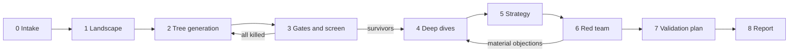

# Pipeline

## Stages



| Stage | Purpose | Load | Write | Checkpoint |
|---|---|---|---|---|
| 0 Intake | Turn the idea into a structured brief: hypothesis, entry point, geography, founder assets, capital, horizon, risk appetite, exclusions, weight profile | `templates/brief.yaml`, `knowledge/*` | `brief.yaml` | **Human confirms the brief** |
| 1 Landscape | Map the sector's value chain, current intermediaries and their take, and the main regulation | `02-transaction-card.md`, `11-evidence.md`, `13-data-sources.md` | First transaction cards; evidence | none |
| 2 Tree | Generate L0–L4 nodes under at least three lenses; deduplicate; cap at 30–60 L3/L4 | `03-market-tree.md`, `config/operators.yaml`, `knowledge/historical-patterns.md` | Nodes in `ledger.yaml` | none |
| 3 Screen | Run the gates, then a quick score on cheap evidence; select 5–8 paths | `04-gates.md`, `config/gates.yaml`, `05-scoring.md`, `config/rubric.yaml`, `knowledge/failure-library.md` | Gate results; kill log; shortlist; `scripts/score.py` output | **Human confirms the shortlist** |
| 4 Deep dive | Full template per path; parallel research; models in code | `07-deep-dive.md`, `06-sizing.md`, `templates/sizing_model.py` | `deep-dives/<path>.md`; `models/`; scores | none |
| 5 Strategy | Wedge, cold start, monetisation, trust, regulation, agents, expansion, exit | `08-strategy.md`, `knowledge/heuristics.md` | Strategy section per path | none |
| 6 Red team | Independent critic attacks each path | `09-red-team.md`, `prompts/critic.md` | `red-team.md`; revised scores | none |
| 7 Validation | Rank assumptions by impact × uncertainty; design cheapest tests | `10-validation.md` | `assumptions` in the ledger | **Human confirms before any spend** |
| 8 Report | Synthesise | `templates/memo.md`, `prompts/synthesiser.md` | `memo.md` | none |

## Roles

| Role | Model guidance | Input | Output |
|---|---|---|---|
| Orchestrator | Thinking model | Brief, ledger, knowledge pack | Tree, gate and score adjudication, strategy |
| Researcher (parallel) | A faster model is fine | One node or question, narrow brief | Evidence entries only (`schemas/evidence.schema.json`), no conclusions |
| Modeller | Any model with a code sandbox | Parameters with evidence ids | Model file, P10/P50/P90 ranges, sensitivity |
| Critic | Separate context; ideally a different model | Memo draft, ledger, evidence. **Not** the orchestrator's reasoning | Ranked objections and required changes |
| Synthesiser | Thinking model, fresh pass | Ledger, deep dives, red team | `memo.md` |

If the runtime cannot spawn sub-agents, run the roles sequentially. Keep the critic in a fresh context, or at minimum have it read only the files listed above.

## Run folder

Create `runs/<run-id>/` (git-ignored by default, because analyses are usually private):

```
runs/<run-id>/
  brief.yaml
  ledger.yaml        # schemas/ledger.schema.json
  evidence.yaml      # schemas/evidence.schema.json
  models/            # sizing and unit-economics code and outputs
  deep-dives/        # one file per shortlisted path
  red-team.md
  memo.md
```

Validate after every stage: `python scripts/validate_ledger.py runs/<run-id>/ledger.yaml`.
Score whenever scores change: `python scripts/score.py runs/<run-id>/ledger.yaml`.

## Budget (starting point)

About 20% on landscape and tree, 15% screen, 40% deep dives, 15% red team and 10% validation and report. The commonest failure is spending the budget on breadth and producing 50 shallow ideas. Respect the caps in `config/operators.yaml`.
